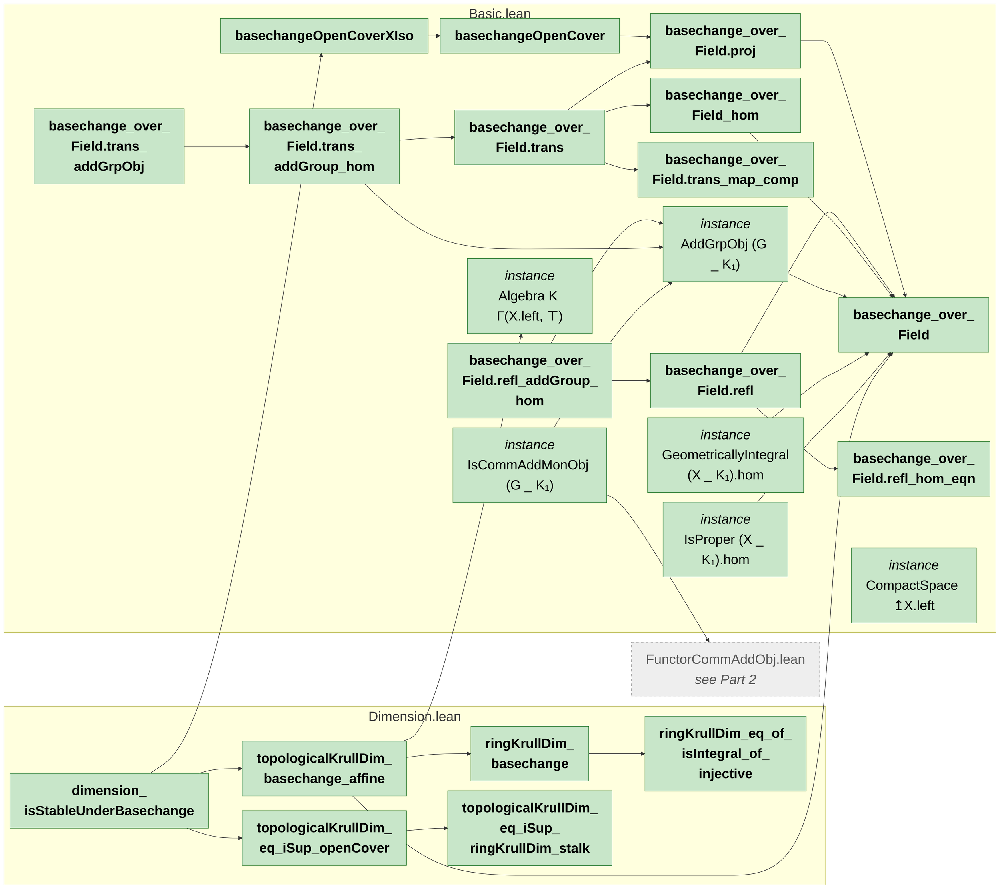
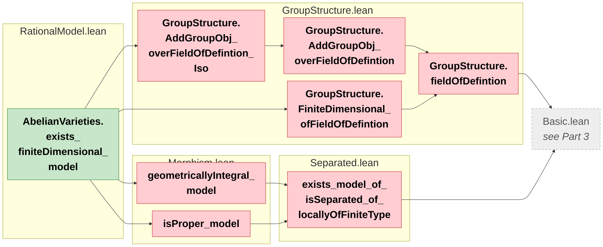

# Mind map: dependencies of `CMStructure.exists_finiteDimensional_model`

Every definition, lemma, theorem and instance from this project that
`CMStructure.exists_finiteDimensional_model` (in `CMAbelianVarieties/Theorem.lean`) depends on,
directly or indirectly. Mathlib is omitted.

So that it stays readable, the picture is split into parts, one diagram each:
1. [Main argument: CM structures, potentially CM, the main theorem](#part-1) (`Theorem`, `Pottentially`, `Defn`)
2. [Endomorphism rings](#part-2) (`AlgebraicGeometry/AbelianVarieties/Homomorphism` except the files of Part 5, `AbstractNonsense/EndRingIso`, `AbstractNonsense/EndBaseChange`, `ForMathlib/Endomorphism`, `ForMathlib/FunctorCommAddObj`, `AlgebraicGeometry/AbelianVarieties/Commutativity`)
3. [Base change of schemes and dimension](#part-3) (`AlgebraicGeometry/Basic`, `AlgebraicGeometry/Dimension`)
4. [Rational models (descent to a finitely generated field)](#part-4) (`AlgebraicGeometry/AbelianVarieties/RationalModel`, `AlgebraicGeometry/RationalModel`)
5. [Finiteness of `End⁰` over finite extensions](#part-5) (`AlgebraicGeometry/AbelianVarieties/Homomorphism/EndLimit`, `…/Homomorphism/RationalModel`, `…/Homomorphism/FiniteGen`)

Inside a part, boxes are grouped by file (labelled by file name only; the folders are listed above).
The one exception is `Homomorphism/RationalModel.lean`, which is labelled with its folder to tell it
apart from `AbelianVarieties/RationalModel.lean` (Part 4).

- An arrow `A --> B` means "A uses B". An arrow `A --> B` is left out when `B` is already
  reachable from `A` through other arrows of the same diagram. Arrows point from left to right.
- 🟨 **golden**: the main result `CMStructure.exists_finiteDimensional_model`
- 🟩 **green**: no `sorry` in its own definition/proof (it may still use red terms)
- 🟥 **red**: contains a `sorry`
- ⬜ **grey, dashed**: a file of another part; an arrow into it means "uses some term of
  that file". The terms themselves (with their colours) are shown in that part.

Labels: the namespaces `AlgebraicGeometry` and `CategoryTheory` are dropped, long names are
broken over several lines, and an instance with an auto-generated name (`inst...`, possibly inside a namespace) is shown by
its type. Constructors and projections of `CMStructure` and `potentiallyCMStructure` are merged
into the structure itself.

> **How to view this as a picture (VS Code):** open this file and press
> **`Ctrl + Shift + V`** to see the rendered diagrams.

## Part 1: Main argument: CM structures, potentially CM, the main theorem

```mermaid
%%{init: {"flowchart": {"useMaxWidth": false, "rankSpacing": 25, "nodeSpacing": 20}, "themeVariables": {"fontSize": "28px"}}}%%
graph LR
  subgraph m_CMAbelianVarieties_Defn["Defn.lean"]
    direction TB
    n_CMStructure["<b>CMStructure</b>"]
    n_CMStructure_Iso["<b>CMStructure.Iso</b>"]
    n_CMStructure_Iso_basechangeTrans["<b>CMStructure.Iso.<br/>basechangeTrans</b>"]
    n_CMStructure_Iso_refl["<b>CMStructure.Iso.refl</b>"]
    n_CMStructure_Iso_symm["<b>CMStructure.Iso.symm</b>"]
    n_CMStructure_Iso_trans["<b>CMStructure.Iso.<br/>trans</b>"]
    n_CMStructure_basechange["<b>CMStructure.<br/>basechange</b>"]
    n_CMStructure_basechange_ofIso["<b>CMStructure.<br/>basechange.ofIso</b>"]
    n_CMStructure_basechange_refl["<b>CMStructure.<br/>basechange.refl</b>"]
    n_CMStructure_basechange_trans["<b>CMStructure.<br/>basechange.trans</b>"]
    n_CMStructure_ofIso["<b>CMStructure.ofIso</b>"]
    n_instCoeCMStructureRingHomRationalEnd["<i>instance</i><br/>Coe (CMStructure A F)<br/>(F →+* End⁰ A)"]
  end
  subgraph m_CMAbelianVarieties_Pottentially["Pottentially.lean"]
    direction TB
    n_potentiallyCMStructure["<b>potentiallyCMStructure</b>"]
    n_potentiallyCMStructure_exists_cmStructure_basechange_iso["<b>potentiallyCMStructure.<br/>exists_cmStructure_<br/>basechange_iso</b>"]
    n_potentiallyCMStructure_of_CMStructure["<b>potentiallyCMStructure.<br/>of_CMStructure</b>"]
  end
  subgraph m_CMAbelianVarieties_Theorem["Theorem.lean"]
    direction TB
    n_CMStructure_exists_finiteDimensional_model["<b>CMStructure.exists_<br/>finiteDimensional_<br/>model</b>"]
  end
  x_CMAbelianVarieties_AbstractNonsense_EndBaseChange["EndBaseChange.lean<br/><i>see Part 2</i>"]
  x_CMAbelianVarieties_AbstractNonsense_EndRingIso["EndRingIso.lean<br/><i>see Part 2</i>"]
  x_CMAbelianVarieties_AlgebraicGeometry_AbelianVarieties_Commutativity["Commutativity.lean<br/><i>see Part 2</i>"]
  x_CMAbelianVarieties_AlgebraicGeometry_AbelianVarieties_Homomorphism_EndomorphismRing["EndomorphismRing.lean<br/><i>see Part 2</i>"]
  x_CMAbelianVarieties_AlgebraicGeometry_AbelianVarieties_Homomorphism_RationalModel["Homomorphism/<br/>RationalModel.lean<br/><i>see Part 5</i>"]
  x_CMAbelianVarieties_AlgebraicGeometry_AbelianVarieties_RationalModel["RationalModel.lean<br/><i>see Part 4</i>"]
  x_CMAbelianVarieties_AlgebraicGeometry_Basic["Basic.lean<br/><i>see Part 3</i>"]
  x_CMAbelianVarieties_AlgebraicGeometry_Dimension["Dimension.lean<br/><i>see Part 3</i>"]
  x_CMAbelianVarieties_ForMathlib_Endomorphism["Endomorphism.lean<br/><i>see Part 2</i>"]

  n_CMStructure --> x_CMAbelianVarieties_AlgebraicGeometry_AbelianVarieties_Commutativity
  n_CMStructure --> x_CMAbelianVarieties_AlgebraicGeometry_AbelianVarieties_Homomorphism_EndomorphismRing
  n_CMStructure --> x_CMAbelianVarieties_ForMathlib_Endomorphism
  n_CMStructure_Iso --> n_instCoeCMStructureRingHomRationalEnd
  n_CMStructure_Iso_basechangeTrans --> n_CMStructure_Iso_symm
  n_CMStructure_Iso_basechangeTrans --> n_CMStructure_Iso_trans
  n_CMStructure_Iso_basechangeTrans --> n_CMStructure_basechange_trans
  n_CMStructure_Iso_refl --> n_CMStructure_Iso
  n_CMStructure_Iso_symm --> n_CMStructure_Iso
  n_CMStructure_Iso_trans --> n_CMStructure_Iso
  n_CMStructure_basechange --> n_instCoeCMStructureRingHomRationalEnd
  n_CMStructure_basechange --> x_CMAbelianVarieties_AlgebraicGeometry_Basic
  n_CMStructure_basechange --> x_CMAbelianVarieties_AlgebraicGeometry_Dimension
  n_CMStructure_basechange_ofIso --> n_CMStructure_Iso
  n_CMStructure_basechange_ofIso --> n_CMStructure_basechange
  n_CMStructure_basechange_ofIso --> x_CMAbelianVarieties_AbstractNonsense_EndBaseChange
  n_CMStructure_basechange_ofIso --> x_CMAbelianVarieties_AbstractNonsense_EndRingIso
  n_CMStructure_basechange_refl --> n_CMStructure_Iso
  n_CMStructure_basechange_refl --> n_CMStructure_basechange
  n_CMStructure_basechange_trans --> n_CMStructure_basechange_ofIso
  n_CMStructure_exists_finiteDimensional_model --> n_CMStructure_Iso_basechangeTrans
  n_CMStructure_exists_finiteDimensional_model --> n_CMStructure_Iso_refl
  n_CMStructure_exists_finiteDimensional_model --> n_CMStructure_basechange_refl
  n_CMStructure_exists_finiteDimensional_model --> n_potentiallyCMStructure_exists_cmStructure_basechange_iso
  n_CMStructure_exists_finiteDimensional_model --> n_potentiallyCMStructure_of_CMStructure
  n_CMStructure_exists_finiteDimensional_model --> x_CMAbelianVarieties_AlgebraicGeometry_AbelianVarieties_RationalModel
  n_CMStructure_ofIso --> n_instCoeCMStructureRingHomRationalEnd
  n_instCoeCMStructureRingHomRationalEnd --> n_CMStructure
  n_potentiallyCMStructure --> n_CMStructure
  n_potentiallyCMStructure --> x_CMAbelianVarieties_AlgebraicGeometry_Basic
  n_potentiallyCMStructure_exists_cmStructure_basechange_iso --> n_CMStructure_Iso
  n_potentiallyCMStructure_exists_cmStructure_basechange_iso --> n_CMStructure_basechange
  n_potentiallyCMStructure_exists_cmStructure_basechange_iso --> n_CMStructure_ofIso
  n_potentiallyCMStructure_exists_cmStructure_basechange_iso --> n_potentiallyCMStructure
  n_potentiallyCMStructure_exists_cmStructure_basechange_iso --> x_CMAbelianVarieties_AlgebraicGeometry_AbelianVarieties_Homomorphism_RationalModel
  n_potentiallyCMStructure_of_CMStructure --> n_potentiallyCMStructure

  classDef ok fill:#c8e6c9,stroke:#2e7d32,color:#000
  classDef bad fill:#ffcdd2,stroke:#c62828,color:#000
  classDef main fill:#ffd54f,stroke:#b8860b,stroke-width:3px,color:#000
  classDef ext fill:#eeeeee,stroke:#9e9e9e,stroke-dasharray:5 5,color:#555
  class n_CMStructure,n_CMStructure_Iso,n_CMStructure_Iso_basechangeTrans,n_CMStructure_Iso_refl,n_CMStructure_Iso_symm,n_CMStructure_Iso_trans,n_CMStructure_basechange,n_CMStructure_basechange_ofIso,n_CMStructure_basechange_refl,n_CMStructure_basechange_trans,n_CMStructure_ofIso,n_instCoeCMStructureRingHomRationalEnd,n_potentiallyCMStructure,n_potentiallyCMStructure_exists_cmStructure_basechange_iso,n_potentiallyCMStructure_of_CMStructure ok
  class n_CMStructure_exists_finiteDimensional_model main
  class x_CMAbelianVarieties_AbstractNonsense_EndBaseChange,x_CMAbelianVarieties_AbstractNonsense_EndRingIso,x_CMAbelianVarieties_AlgebraicGeometry_AbelianVarieties_Commutativity,x_CMAbelianVarieties_AlgebraicGeometry_AbelianVarieties_Homomorphism_EndomorphismRing,x_CMAbelianVarieties_AlgebraicGeometry_AbelianVarieties_Homomorphism_RationalModel,x_CMAbelianVarieties_AlgebraicGeometry_AbelianVarieties_RationalModel,x_CMAbelianVarieties_AlgebraicGeometry_Basic,x_CMAbelianVarieties_AlgebraicGeometry_Dimension,x_CMAbelianVarieties_ForMathlib_Endomorphism ext
```

## Part 2: Endomorphism rings

```mermaid
%%{init: {"flowchart": {"useMaxWidth": false, "rankSpacing": 25, "nodeSpacing": 20}, "themeVariables": {"fontSize": "28px"}}}%%
graph LR
  subgraph m_CMAbelianVarieties_AbstractNonsense_EndBaseChange["EndBaseChange.lean"]
    direction TB
    n_AddGrp_End_algHom_ofBaseChange["<b>AddGrp.End.algHom_<br/>ofBaseChange</b>"]
  end
  subgraph m_CMAbelianVarieties_AbstractNonsense_EndRingIso["EndRingIso.lean"]
    direction TB
    n_CategoryTheory_Iso_conjAlgEquiv["<b>Iso.conjAlgEquiv</b>"]
    n_CategoryTheory_Iso_conjRingEquiv["<b>Iso.conjRingEquiv</b>"]
  end
  subgraph m_CMAbelianVarieties_AlgebraicGeometry_AbelianVarieties_Commutativity["Commutativity.lean"]
    direction TB
    n_AlgebraicGeometry_isClosedImmersion_zero_left["<b>isClosedImmersion_<br/>zero_left</b>"]
    n_AlgebraicGeometry_isCommAddMonObj_of_isProper_of_geometricallyIntegral["<b>isCommAddMonObj_of_<br/>isProper_of_<br/>geometricallyIntegral</b>"]
    n_AlgebraicGeometry_isCommAddMonObj_of_isProper_of_isIntegral_tensorObj_of_isAlgClosed["<b>isCommAddMonObj_of_<br/>isProper_of_<br/>isIntegral_<br/>tensorObj_of_<br/>isAlgClosed</b>"]
    n_instIsCommAddMonObjOverSchemeSpecOf_cMAbelianVarieties["<i>instance</i><br/>IsCommAddMonObj A"]
  end
  subgraph m_CMAbelianVarieties_AlgebraicGeometry_AbelianVarieties_Homomorphism_EndomorphismRing["EndomorphismRing.lean"]
    direction TB
    n_End_algHom_ofBaseChange["<b>End.algHom_<br/>ofBaseChange</b>"]
    n_End_baseChangeHom["<b>End.baseChangeHom</b>"]
    n_End_baseChangeHom_inj["<b>End.baseChangeHom_<br/>inj</b>"]
    n_End_baseChangeHom_left_comp_proj["<b>End.baseChangeHom_<br/>left_comp_proj</b>"]
    n_End_eq_baseChangeHom_iff["<b>End.eq_<br/>baseChangeHom_iff</b>"]
    n_End_ext_of_left_comp_fst["<b>End.ext_of_left_<br/>comp_fst</b>"]
    n_RationalEnd["<b>RationalEnd</b>"]
    n_RationalEnd_baseChangeHom["<b>RationalEnd.<br/>baseChangeHom</b>"]
    n_RationalEnd_baseChangeHom_comp["<b>RationalEnd.<br/>baseChangeHom_comp</b>"]
    n_RationalEnd_baseChangeHom_eq_map["<b>RationalEnd.<br/>baseChangeHom_eq_map</b>"]
    n_RationalEnd_baseChangeHom_inj["<b>RationalEnd.<br/>baseChangeHom_inj</b>"]
    n_RationalEnd_baseChangeHom_self["<b>RationalEnd.<br/>baseChangeHom_self</b>"]
    n_RationalEnd_conjAlgEquiv["<b>RationalEnd.<br/>conjAlgEquiv</b>"]
    n_RationalEnd_conjAlgEquiv_refl["<b>RationalEnd.<br/>conjAlgEquiv.refl</b>"]
    n_RationalEnd_conjAlgEquiv_symm["<b>RationalEnd.<br/>conjAlgEquiv.symm</b>"]
    n_RationalEnd_conjAlgEquiv_trans["<b>RationalEnd.<br/>conjAlgEquiv.trans</b>"]
    n_RationalEnd_instFiniteRat["<i>instance</i><br/>Module.Finite ℚ (End⁰ A)"]
    n_RationalEnd_rational_end_morphism["<b>RationalEnd.<br/>rational_end_<br/>morphism</b>"]
    n_RationalEnd_rational_end_morphism_eq_baseChangeHom_comp["<b>RationalEnd.<br/>rational_end_<br/>morphism_eq_<br/>baseChangeHom_comp</b>"]
  end
  subgraph m_CMAbelianVarieties_ForMathlib_Endomorphism["Endomorphism.lean"]
    direction TB
    n_AddGrp_End_instAddCommGroupEndAddGrpOfIsCommAddMonObjX_cMAbelianVarieties["<i>instance</i><br/>AddCommGroup (End G)"]
    n_AddGrp_End_instAddEndAddGrpOfIsCommAddMonObjX_cMAbelianVarieties["<i>instance</i><br/>Add (End G)"]
    n_AddGrp_End_instRingEndAddGrpOfIsCommAddMonObjX_cMAbelianVarieties["<i>instance</i><br/>Ring (End G)"]
    n_AddGrp_End_instZeroEndAddGrp_cMAbelianVarieties["<i>instance</i><br/>Zero (End G)"]
    n_AddMon_End_instAddCommMonoidEndAddMonOfIsCommAddMonObjX_cMAbelianVarieties["<i>instance</i><br/>AddCommMonoid (End G)"]
    n_AddMon_End_instAddEndAddMonOfIsCommAddMonObjX_cMAbelianVarieties["<i>instance</i><br/>Add (End G)"]
    n_AddMon_End_instZeroEndAddMon_cMAbelianVarieties["<i>instance</i><br/>Zero (End G)"]
    n_instAddCommMonoidHomAddMonOfIsCommAddMonObjX_cMAbelianVarieties["<i>instance</i><br/>AddCommMonoid (G ⟶ G)"]
  end
  subgraph m_CMAbelianVarieties_ForMathlib_FunctorCommAddObj["FunctorCommAddObj.lean"]
    direction TB
    n_Functor_isCommAddMonObj_obj["<b>Functor.<br/>isCommAddMonObj_obj</b>"]
  end
  x_CMAbelianVarieties_AlgebraicGeometry_AbelianVarieties_Homomorphism_FiniteGen["FiniteGen.lean<br/><i>see Part 5</i>"]
  x_CMAbelianVarieties_AlgebraicGeometry_Basic["Basic.lean<br/><i>see Part 3</i>"]

  n_AddGrp_End_algHom_ofBaseChange --> n_AddGrp_End_instRingEndAddGrpOfIsCommAddMonObjX_cMAbelianVarieties
  n_AddGrp_End_algHom_ofBaseChange --> n_Functor_isCommAddMonObj_obj
  n_AddGrp_End_instAddCommGroupEndAddGrpOfIsCommAddMonObjX_cMAbelianVarieties --> n_AddGrp_End_instAddEndAddGrpOfIsCommAddMonObjX_cMAbelianVarieties
  n_AddGrp_End_instAddCommGroupEndAddGrpOfIsCommAddMonObjX_cMAbelianVarieties --> n_AddGrp_End_instZeroEndAddGrp_cMAbelianVarieties
  n_AddGrp_End_instAddCommGroupEndAddGrpOfIsCommAddMonObjX_cMAbelianVarieties --> n_AddMon_End_instAddCommMonoidEndAddMonOfIsCommAddMonObjX_cMAbelianVarieties
  n_AddGrp_End_instRingEndAddGrpOfIsCommAddMonObjX_cMAbelianVarieties --> n_AddGrp_End_instAddCommGroupEndAddGrpOfIsCommAddMonObjX_cMAbelianVarieties
  n_AddMon_End_instAddCommMonoidEndAddMonOfIsCommAddMonObjX_cMAbelianVarieties --> n_AddMon_End_instAddEndAddMonOfIsCommAddMonObjX_cMAbelianVarieties
  n_AddMon_End_instAddCommMonoidEndAddMonOfIsCommAddMonObjX_cMAbelianVarieties --> n_AddMon_End_instZeroEndAddMon_cMAbelianVarieties
  n_AddMon_End_instAddEndAddMonOfIsCommAddMonObjX_cMAbelianVarieties --> n_instAddCommMonoidHomAddMonOfIsCommAddMonObjX_cMAbelianVarieties
  n_AlgebraicGeometry_isCommAddMonObj_of_isProper_of_geometricallyIntegral --> n_AlgebraicGeometry_isCommAddMonObj_of_isProper_of_isIntegral_tensorObj_of_isAlgClosed
  n_AlgebraicGeometry_isCommAddMonObj_of_isProper_of_isIntegral_tensorObj_of_isAlgClosed --> n_AlgebraicGeometry_isClosedImmersion_zero_left
  n_CategoryTheory_Iso_conjAlgEquiv --> n_AddGrp_End_instRingEndAddGrpOfIsCommAddMonObjX_cMAbelianVarieties
  n_CategoryTheory_Iso_conjAlgEquiv --> n_CategoryTheory_Iso_conjRingEquiv
  n_CategoryTheory_Iso_conjRingEquiv --> n_AddGrp_End_instAddEndAddGrpOfIsCommAddMonObjX_cMAbelianVarieties
  n_End_algHom_ofBaseChange --> n_AddGrp_End_algHom_ofBaseChange
  n_End_algHom_ofBaseChange --> x_CMAbelianVarieties_AlgebraicGeometry_Basic
  n_End_baseChangeHom --> n_CategoryTheory_Iso_conjAlgEquiv
  n_End_baseChangeHom --> n_End_algHom_ofBaseChange
  n_End_baseChangeHom --> n_instIsCommAddMonObjOverSchemeSpecOf_cMAbelianVarieties
  n_End_baseChangeHom_inj --> n_End_baseChangeHom_left_comp_proj
  n_End_baseChangeHom_inj --> n_End_ext_of_left_comp_fst
  n_End_baseChangeHom_left_comp_proj --> n_End_baseChangeHom
  n_End_eq_baseChangeHom_iff --> n_End_baseChangeHom_left_comp_proj
  n_End_eq_baseChangeHom_iff --> n_End_ext_of_left_comp_fst
  n_End_ext_of_left_comp_fst --> x_CMAbelianVarieties_AlgebraicGeometry_Basic
  n_RationalEnd --> n_AddGrp_End_instRingEndAddGrpOfIsCommAddMonObjX_cMAbelianVarieties
  n_RationalEnd --> n_instIsCommAddMonObjOverSchemeSpecOf_cMAbelianVarieties
  n_RationalEnd_baseChangeHom --> n_RationalEnd_rational_end_morphism
  n_RationalEnd_baseChangeHom_comp --> n_End_eq_baseChangeHom_iff
  n_RationalEnd_baseChangeHom_comp --> n_RationalEnd_baseChangeHom
  n_RationalEnd_baseChangeHom_eq_map --> n_RationalEnd_baseChangeHom
  n_RationalEnd_baseChangeHom_inj --> n_End_baseChangeHom_inj
  n_RationalEnd_baseChangeHom_inj --> n_RationalEnd_baseChangeHom_eq_map
  n_RationalEnd_baseChangeHom_self --> n_End_eq_baseChangeHom_iff
  n_RationalEnd_baseChangeHom_self --> n_RationalEnd_baseChangeHom
  n_RationalEnd_conjAlgEquiv --> n_CategoryTheory_Iso_conjAlgEquiv
  n_RationalEnd_conjAlgEquiv --> n_RationalEnd
  n_RationalEnd_conjAlgEquiv_refl --> n_RationalEnd_conjAlgEquiv
  n_RationalEnd_conjAlgEquiv_symm --> n_RationalEnd_conjAlgEquiv
  n_RationalEnd_conjAlgEquiv_trans --> n_RationalEnd_conjAlgEquiv
  n_RationalEnd_instFiniteRat --> n_RationalEnd
  n_RationalEnd_instFiniteRat --> x_CMAbelianVarieties_AlgebraicGeometry_AbelianVarieties_Homomorphism_FiniteGen
  n_RationalEnd_rational_end_morphism --> n_End_baseChangeHom
  n_RationalEnd_rational_end_morphism --> n_RationalEnd_conjAlgEquiv
  n_RationalEnd_rational_end_morphism_eq_baseChangeHom_comp --> n_End_eq_baseChangeHom_iff
  n_RationalEnd_rational_end_morphism_eq_baseChangeHom_comp --> n_RationalEnd_baseChangeHom
  n_instIsCommAddMonObjOverSchemeSpecOf_cMAbelianVarieties --> n_AlgebraicGeometry_isCommAddMonObj_of_isProper_of_geometricallyIntegral

  classDef ok fill:#c8e6c9,stroke:#2e7d32,color:#000
  classDef bad fill:#ffcdd2,stroke:#c62828,color:#000
  classDef main fill:#ffd54f,stroke:#b8860b,stroke-width:3px,color:#000
  classDef ext fill:#eeeeee,stroke:#9e9e9e,stroke-dasharray:5 5,color:#555
  class n_AddGrp_End_algHom_ofBaseChange,n_AddGrp_End_instAddCommGroupEndAddGrpOfIsCommAddMonObjX_cMAbelianVarieties,n_AddGrp_End_instAddEndAddGrpOfIsCommAddMonObjX_cMAbelianVarieties,n_AddGrp_End_instRingEndAddGrpOfIsCommAddMonObjX_cMAbelianVarieties,n_AddGrp_End_instZeroEndAddGrp_cMAbelianVarieties,n_AddMon_End_instAddCommMonoidEndAddMonOfIsCommAddMonObjX_cMAbelianVarieties,n_AddMon_End_instAddEndAddMonOfIsCommAddMonObjX_cMAbelianVarieties,n_AddMon_End_instZeroEndAddMon_cMAbelianVarieties,n_AlgebraicGeometry_isClosedImmersion_zero_left,n_AlgebraicGeometry_isCommAddMonObj_of_isProper_of_geometricallyIntegral,n_AlgebraicGeometry_isCommAddMonObj_of_isProper_of_isIntegral_tensorObj_of_isAlgClosed,n_CategoryTheory_Iso_conjAlgEquiv,n_CategoryTheory_Iso_conjRingEquiv,n_End_algHom_ofBaseChange,n_End_baseChangeHom,n_End_baseChangeHom_inj,n_End_baseChangeHom_left_comp_proj,n_End_eq_baseChangeHom_iff,n_End_ext_of_left_comp_fst,n_Functor_isCommAddMonObj_obj,n_RationalEnd,n_RationalEnd_baseChangeHom,n_RationalEnd_baseChangeHom_comp,n_RationalEnd_baseChangeHom_eq_map,n_RationalEnd_baseChangeHom_inj,n_RationalEnd_baseChangeHom_self,n_RationalEnd_conjAlgEquiv,n_RationalEnd_conjAlgEquiv_refl,n_RationalEnd_conjAlgEquiv_symm,n_RationalEnd_conjAlgEquiv_trans,n_RationalEnd_instFiniteRat,n_RationalEnd_rational_end_morphism,n_RationalEnd_rational_end_morphism_eq_baseChangeHom_comp,n_instAddCommMonoidHomAddMonOfIsCommAddMonObjX_cMAbelianVarieties,n_instIsCommAddMonObjOverSchemeSpecOf_cMAbelianVarieties ok
  class x_CMAbelianVarieties_AlgebraicGeometry_AbelianVarieties_Homomorphism_FiniteGen,x_CMAbelianVarieties_AlgebraicGeometry_Basic ext
```

## Part 3: Base change of schemes and dimension

## Part 4: Rational models (descent to a finitely generated field)

## Part 5: Finiteness of `End⁰` over finite extensions

```mermaid
%%{init: {"flowchart": {"useMaxWidth": false, "rankSpacing": 25, "nodeSpacing": 20}, "themeVariables": {"fontSize": "28px"}}}%%
graph LR
  subgraph m_CMAbelianVarieties_AlgebraicGeometry_AbelianVarieties_Homomorphism_EndLimit["EndLimit.lean"]
    direction TB
    n_RatEnd["<b>RatEnd</b>"]
    n_RatEndFin["<b>RatEndFin</b>"]
    n_limitRatEnd["<b>limitRatEnd</b>"]
    n_limitRatEnd_isColimit["<b>limitRatEnd.<br/>isColimit</b>"]
    n_limitRatEndFin["<b>limitRatEndFin</b>"]
  end
  subgraph m_CMAbelianVarieties_AlgebraicGeometry_AbelianVarieties_Homomorphism_FiniteGen["FiniteGen.lean"]
    direction TB
    n_fin_gen_end["<b>fin_gen_end</b>"]
  end
  subgraph m_CMAbelianVarieties_AlgebraicGeometry_AbelianVarieties_Homomorphism_RationalModel["Homomorphism/<br/>RationalModel.lean"]
    direction TB
    n_I["<b>I</b>"]
    n_exists_baseChangeHom_eq_u212c["<b>exists_<br/>baseChangeHom_eq_ℬ</b>"]
    n_exists_finiteDimensional_bijective_baseChangeHom["<b>exists_<br/>finiteDimensional_<br/>bijective_<br/>baseChangeHom</b>"]
    n_u212c["<b>ℬ</b>"]
  end
  x_CMAbelianVarieties_AlgebraicGeometry_AbelianVarieties_Commutativity["Commutativity.lean<br/><i>see Part 2</i>"]
  x_CMAbelianVarieties_AlgebraicGeometry_AbelianVarieties_Homomorphism_EndomorphismRing["EndomorphismRing.lean<br/><i>see Part 2</i>"]
  x_CMAbelianVarieties_AlgebraicGeometry_Basic["Basic.lean<br/><i>see Part 3</i>"]
  x_CMAbelianVarieties_ForMathlib_Endomorphism["Endomorphism.lean<br/><i>see Part 2</i>"]

  n_I --> x_CMAbelianVarieties_AlgebraicGeometry_AbelianVarieties_Homomorphism_EndomorphismRing
  n_I --> x_CMAbelianVarieties_AlgebraicGeometry_Basic
  n_I --> x_CMAbelianVarieties_ForMathlib_Endomorphism
  n_RatEnd --> x_CMAbelianVarieties_AlgebraicGeometry_AbelianVarieties_Commutativity
  n_RatEnd --> x_CMAbelianVarieties_AlgebraicGeometry_AbelianVarieties_Homomorphism_EndomorphismRing
  n_RatEnd --> x_CMAbelianVarieties_AlgebraicGeometry_Basic
  n_RatEnd --> x_CMAbelianVarieties_ForMathlib_Endomorphism
  n_RatEndFin --> n_RatEnd
  n_exists_baseChangeHom_eq_u212c --> n_limitRatEnd_isColimit
  n_exists_baseChangeHom_eq_u212c --> n_u212c
  n_exists_finiteDimensional_bijective_baseChangeHom --> n_exists_baseChangeHom_eq_u212c
  n_fin_gen_end --> x_CMAbelianVarieties_AlgebraicGeometry_AbelianVarieties_Commutativity
  n_fin_gen_end --> x_CMAbelianVarieties_ForMathlib_Endomorphism
  n_limitRatEnd --> n_RatEnd
  n_limitRatEnd_isColimit --> n_limitRatEndFin
  n_limitRatEndFin --> n_RatEndFin
  n_limitRatEndFin --> n_limitRatEnd
  n_u212c --> n_I

  classDef ok fill:#c8e6c9,stroke:#2e7d32,color:#000
  classDef bad fill:#ffcdd2,stroke:#c62828,color:#000
  classDef main fill:#ffd54f,stroke:#b8860b,stroke-width:3px,color:#000
  classDef ext fill:#eeeeee,stroke:#9e9e9e,stroke-dasharray:5 5,color:#555
  class n_I,n_RatEnd,n_RatEndFin,n_exists_baseChangeHom_eq_u212c,n_exists_finiteDimensional_bijective_baseChangeHom,n_limitRatEnd,n_limitRatEndFin,n_u212c ok
  class n_fin_gen_end,n_limitRatEnd_isColimit bad
  class x_CMAbelianVarieties_AlgebraicGeometry_AbelianVarieties_Commutativity,x_CMAbelianVarieties_AlgebraicGeometry_AbelianVarieties_Homomorphism_EndomorphismRing,x_CMAbelianVarieties_AlgebraicGeometry_Basic,x_CMAbelianVarieties_ForMathlib_Endomorphism ext
```

