# Mind map of file dependencies

Only imports between files of this project are shown (Mathlib is omitted).
An arrow `A --> B` means "A imports B". `CMAbelianVarieties.lean` imports every file below except `Test`.

> **How to view this as a picture (VS Code):** open this file and press
> **`Ctrl + Shift + V`** to see the rendered diagram.

```mermaid
graph TD
  %% ---------- top level ----------
  Theorem["<b>Theorem</b><br/><i>main theorem: CM abelian varieties have models over number fields</i>"]
  Defn["<b>Defn</b><br/><i>CMStructure, CMType</i>"]

  %% ---------- AbelianVarieties ----------
  subgraph AV["AbelianVarieties/"]
    direction TB
    GlobalSections["<b>GlobalSections</b><br/><i>Γ(A) ≅ K</i>"]
    TateModule["<b>TateModule</b><br/><i>torsion points, Tate module</i>"]
    BaseFieldChange["<b>BaseFieldChange</b><br/><i>A _ K₁, base change to K₁</i>"]
    AVCatalogue["<b>Catalogue</b><br/><i>#check cheat sheet</i>"]
    subgraph HOM["Homomorphisms/"]
      direction TB
      EndomorphismRing["<b>EndomorphismRing</b><br/><i>End A, End A ⊗ ℚ</i>"]
      FiniteGen["<b>FiniteGen</b><br/><i>Hom(A, B) finitely generated</i>"]
      TorsionFree["<b>TorsionFree</b><br/><i>Hom(A, B) torsion free</i>"]
      IntHomAV["<b>IntHom</b> ★<br/><i>[n], A[n] finite & discrete</i>"]
    end
  end

  %% ---------- AbstractNonsense ----------
  subgraph AN["AbstractNonsense/"]
    direction TB
    IntHomAN["<b>IntHom</b><br/><i>[n] on group objects</i>"]
    PullbackAddGrp["<b>PullbackAddGrp</b><br/><i>group structure on pullbacks</i>"]
    EndBaseChange["<b>EndBaseChange</b><br/><i>End G →ₐ[ℤ] End (F.obj G)</i>"]
    EndRingIso["<b>EndRingIso</b><br/><i>G ≅ H ⇒ End G ≃+* End H</i>"]
  end

  %% ---------- AlgebraicGeometry ----------
  subgraph AG["AlgebraicGeometry/"]
    direction TB
    Finite["<b>Finite</b><br/><i>finite over a field ⇒ Artinian</i>"]
    InvertibleSheaf["<b>InvertibleSheaf</b><br/><i>line bundles</i>"]
    TheCube["<b>TheCube</b><br/><i>theorem of the cube</i>"]
    LieAlgebra["<b>LieAlgebra</b><br/><i>Lie G, End G acts on Lie G</i>"]
    Dimension["<b>Dimension</b><br/><i>dim X = sup of dim 𝒪_{X,x}; dim Lie G vs dim 𝒪_{G,e}</i>"]
    AGCatalogue["<b>Catalogue</b><br/><i>#check cheat sheet</i>"]
  end

  %% ---------- ForMathlib ----------
  subgraph FM["ForMathlib/"]
    Endomorphism["<b>Endomorphism</b><br/><i>End G is a (semi)ring</i>"]
    FunctorCommAddObj["<b>FunctorCommAddObj</b><br/><i>F preserves comm. add. monoid objects</i>"]
  end

  %% ---------- CMTypes ----------
  subgraph CM["CMTypes/"]
    direction TB
    CMDefn["<b>Defn</b><br/><i>preCMType</i>"]
    CMAlgebra["<b>Algebra</b><br/><i>background for CM types</i>"]
  end

  %% ---------- Test ----------
  subgraph T["Test/ (top level, outside the library)"]
    Test["<b>Test</b><br/><i>scratch</i>"]
  end

  %% ---------- imports ----------
  Theorem --> Defn
  Defn --> EndomorphismRing
  Defn --> CMDefn
  Defn --> BaseFieldChange
  Defn --> EndBaseChange
  BaseFieldChange --> FunctorCommAddObj
  EndBaseChange --> Endomorphism
  EndBaseChange --> FunctorCommAddObj
  EndomorphismRing --> IntHomAV
  EndomorphismRing --> EndRingIso
  EndRingIso --> Endomorphism
  FiniteGen --> TateModule
  TateModule --> IntHomAV
  TorsionFree --> GlobalSections
  TorsionFree --> IntHomAV
  IntHomAV --> IntHomAN
  IntHomAV --> PullbackAddGrp
  IntHomAV --> Finite
  IntHomAN --> Endomorphism
  LieAlgebra --> Endomorphism
  Test --> Defn

  %% ---------- colours ----------
  classDef goal fill:#fde2e4,stroke:#c0392b,stroke-width:2px,color:#000
  classDef hub fill:#fff3bf,stroke:#e67700,stroke-width:3px,color:#000
  classDef connected fill:#e7f5ff,stroke:#1c7ed6,color:#000
  classDef unused fill:#f1f3f5,stroke:#adb5bd,stroke-dasharray:4 3,color:#495057

  class Theorem goal
  class IntHomAV hub
  class EndomorphismRing,FiniteGen,TorsionFree,TateModule,GlobalSections,IntHomAN,PullbackAddGrp,Finite,Endomorphism,LieAlgebra,CMDefn,Test,BaseFieldChange,EndBaseChange,FunctorCommAddObj,Defn,EndRingIso connected
  class AVCatalogue,InvertibleSheaf,TheCube,AGCatalogue,Dimension,CMAlgebra unused
```

**Legend**

| Colour | Meaning |
|---|---|
| Red, thick border | the main goal (`Theorem`) |
| Yellow, thick border ★ | the hub (`Homomorphisms/IntHom`, imported by 3 files) |
| Blue | part of the dependency chain |
| Grey, dashed | not connected to the rest yet |
